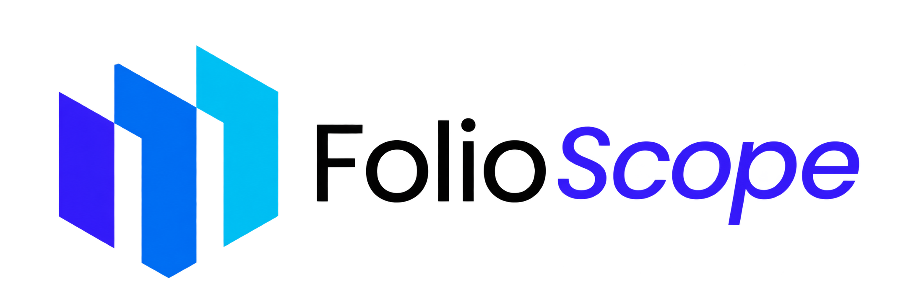
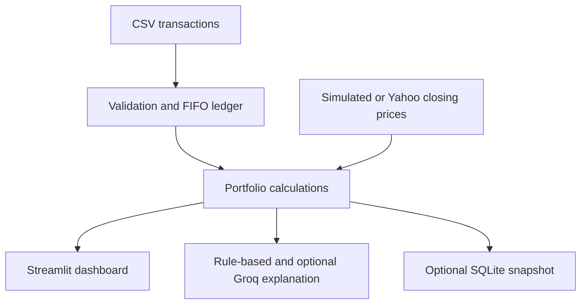

# FolioScope



**A personal investment tracker that separates what you own from how your investments performed.**

You have a spreadsheet of stock purchases and sales. You can see what you paid, but answering a simple question such as *"How much have I actually made?"* takes more work than adding up the rows. Some shares were bought at different prices, some were sold, and buying more shares can make the portfolio's value rise even when prices stay flat.

FolioScope takes those transactions, calculates the remaining holdings using FIFO accounting, adds historical closing prices, and displays the result in a Streamlit dashboard. An optional Groq explanation describes the calculated figures and can look for recent market context. The AI never replaces the accounting code.

**Current scope:** USD-denominated, long-only stock and ETF transactions entered through CSV. No brokerage login, trading, forecasting, or investment recommendations.

---

## Why this exists

A portfolio's **value**, **profit**, and **return** answer different questions. Mixing them produces convincing-looking charts with incorrect conclusions.

Take a simple case: you buy one share for $100 on Monday and another for $100 on Wednesday. The share price does not move.

| | Monday | Wednesday |
| --- | ---: | ---: |
| Shares held | 1 | 2 |
| Share price | $100 | $100 |
| Portfolio value | $100 | $200 |
| Price-based investment return | 0% | 0% |

The value doubled because you purchased another share, **not because the investment earned 100%**. `portfolio/analytics.py` models close-to-close price changes using the *previous day's* holdings to avoid that mistake. `test_a_new_deposit_is_not_counted_as_return` verifies the example with fixed prices.

The model is still approximate, not a complete broker-grade time-weighted return calculation. That distinction is part of the design, not a footnote.

## Quickstart

Requires **Python 3.11+**. The built-in demo needs no brokerage account, paid API key, or live market connection. Download/extract the project, open the `folioscope` folder in VS Code, and start a terminal **inside that folder**.

### Windows (PowerShell)

```powershell
py -m venv .venv
.venv\Scripts\python.exe -m pip install -r requirements.txt
.venv\Scripts\python.exe -m streamlit run app.py
```

### macOS / Linux

```bash
python3 -m venv .venv
source .venv/bin/activate
python -m pip install -r requirements.txt
python -m streamlit run app.py
```

After the repository has been published, users can instead clone its real GitHub URL and run these commands inside the clone. Streamlit normally opens `http://localhost:8501`.

In the **left sidebar**:

1. Choose **Use example transactions**.
2. Choose **Simulated example prices**. Both the trades and prices in this demo are fictional.
3. Explore **Summary**, then **Holdings & trades** to see exactly what was imported.
4. Download the example CSV and switch to **Upload my CSV**. The downloaded file can be reuploaded unchanged.
5. Switch to **Yahoo Finance closing prices** only when you want historical market data and have an internet connection.

## Architecture



`app.py` handles interaction and presentation. Financial rules live in `portfolio/`, where they can be tested without a browser. The price provider can change without rewriting the ledger, and the AI layer only receives results that Python has already calculated.

## The transaction contract

FolioScope expects one **BUY** or **SELL** per CSV row:

```csv
date,ticker,side,quantity,price,fee
2026-01-05,AAPL,BUY,4,245,1
2026-04-02,AAPL,BUY,2,260,1
2026-06-15,AAPL,SELL,3,270,1
```

| Field | Rule | Why |
| --- | --- | --- |
| `date` | `YYYY-MM-DD`, not in the future | Places trades in chronological order |
| `ticker` | Stock or ETF symbol such as `AAPL` | Identifies which lots belong together |
| `side` | `BUY` or `SELL` | Determines whether shares enter or leave holdings |
| `quantity` | Positive number | Prevents invalid lots |
| `price` | Positive USD amount per share | Supplies transaction cost or sale proceeds |
| `fee` | Nonnegative USD amount | Included in FIFO cost or net sale proceeds |

The importer accepts header capitalization, surrounding spaces, UTF-8 BOMs, and semicolon-separated Excel CSVs. It rejects missing fields, invalid numbers, and attempts to sell more shares than have been purchased. The included `data/sample_transactions.csv` is also the exact file served by the dashboard's download button; a round-trip test confirms it parses successfully.

Only **up to 12 symbols** and **USD** transactions are supported. PDFs, screenshots, brokerage statements, and direct brokerage connections are outside this version's scope. Uploaded trades remain in the Streamlit session; the app does not automatically save the original CSV to SQLite.

## FIFO: why the order of purchases matters

`portfolio/ledger.py` stores each purchase as a separate lot and consumes the oldest lot first when shares are sold. It uses Python's `Decimal` for trade quantities, prices, and fees rather than beginning with binary floating-point values.

The following case is covered by `test_fifo_cost_basis_and_realized_profit`:

| Transaction | Shares | Price | Fee |
| --- | ---: | ---: | ---: |
| BUY | 2 | $100 | $2 |
| BUY | 1 | $120 | $0 |
| SELL | 2.5 | $150 | $1 |

The first lot cost $101 per share after allocating its fee. The sale consumes both shares from that lot and half a share from the second lot.

```text
Net sale proceeds       (2.5 × $150) − $1       = $374
Cost of shares sold     (2 × $101) + (0.5 × $120) = $262
Realized profit                                    = $112

Remaining shares                                   = 0.5
Remaining cost basis                               = $60
```

Why FIFO? It is predictable, easy to test, and demonstrates lot-level accounting. It is **not** a claim that every broker or tax system uses FIFO. Fully sold positions retain their realized profit/loss, even though no shares remain.

## Market data: a usable demo without pretending it is live

There are two intentionally separate sources in `portfolio/market.py`:

**Simulated example prices.** NumPy generates a deterministic business-day price series from a stable ticker-based seed. This keeps the demo useful offline and makes tests reproducible. These figures are neither historical quotes nor forecasts.

**Yahoo Finance closing prices.** `yfinance` fetches unadjusted daily closes and checks that the reported quote currency is USD. The app rejects missing or incompatible quote data instead of quietly treating an unavailable price as zero. Yahoo Finance is an unofficial third-party source with availability and usage restrictions. The quotes are not live execution prices.

The UI labels the selected source and the date of the latest quote. Streamlit caches identical price requests for 15 minutes to avoid unnecessary repeated downloads.

## What the dashboard calculates

The interface has five tabs rather than putting every number and control on one screen:

| Tab | Purpose |
| --- | --- |
| **Summary** | Current market value, unrealized/realized P/L, holdings value over time, allocation |
| **Holdings & trades** | Remaining quantities, cost basis, last price, weights, imported rows, CSV export |
| **Performance & risk** | Approximate return index, historical volatility, maximum drawdown |
| **AI explanation** | Plain-language deterministic observations, plus optional Groq analysis |
| **Data & help** | CSV instructions, limitations, and saved SQLite snapshots |

Two choices in the sidebar control **which transactions** are analysed and **where prices come from**. The AI key and search option are in the AI tab because they aren't needed to use the main tracker.

The value-history line is *not* presented as a return chart. The modeled return index estimates the price changes experienced by previously held shares, compounds those daily estimates, and begins at 100. Historical volatility scales the standard deviation of modeled daily returns by √252; drawdown measures decline from a previous modeled peak. None of these should be read as a verified account return or a prediction.

## Groq: an explanation, not the source of the numbers

The basic notes in `portfolio/insights.py` are ordinary Python rules and work with **no AI key**. The optional explanation sends aggregate metrics, holdings tickers and weights, and the selected focus ticker to Groq. It does **not** transmit the raw CSV or full transaction ledger.

The default model is `openai/gpt-oss-20b`. The user can enable Groq's built-in `browser_search` tool for recent public context, then press **Explain portfolio**. No call is made automatically on every dashboard refresh.

There is an important evidence boundary:

- **Calculated fact:** Python establishes the holdings and profit/loss figures.
- **External context:** Groq may return an article or other public link about the focus ticker.
- **Interpretation:** An article discussing a company does not prove it caused a particular price movement.

FolioScope shows HTTPS links found in the model's answer, but it **does not independently retrieve or verify those pages**. If no usable links are returned, the UI warns you. With simulated prices, the prompt explicitly prohibits attributing fictional market movements to real events.

To try it, get a key from [Groq Console](https://console.groq.com/keys) and enter it in the AI tab. Alternatively, set `GROQ_API_KEY` in your local environment. `GROQ_MODEL` can override the default model. `.env.example` documents these settings, but the app does not automatically load a `.env` file.

Keep keys out of Git. A server-configured key is never prefilled into the browser field, although deploying a shared key on a public app still risks other visitors consuming its quota. Groq calls and browser search may incur charges under your account's current limits. See the [Groq browser-search documentation](https://console.groq.com/docs/tool-use/built-in-tools/browser-search).

## Snapshots and automation

The dashboard refreshes its market-data section while a browser session is active; **closing the browser does not leave a background collector running**.

For scheduled recording, `scripts/save_snapshot.py` reuses the same calculation pipeline and writes timestamp, portfolio value, and source (`simulated` or `yahoo`) into local SQLite:

```bash
# No network required
python scripts/save_snapshot.py --demo

# Yahoo Finance closes and your own transaction CSV
python scripts/save_snapshot.py --trades data/your_transactions.csv
```

Run the command on a schedule with Windows Task Scheduler or cron if you want regular snapshots. The machine must be running. `data/snapshots.db` is ignored by Git, and a temporary cloud host might not preserve local SQLite files between restarts.

## Tests and reproducibility

The project has **19 automated Python tests**, last run successfully against the local source. These include FIFO fees and overselling, a downloaded-template CSV round-trip, Excel CSV variations, unchanged-price purchases, drawdown, repeatable synthetic quotes, SQLite persistence, Groq request construction without live API calls, source-link extraction, and a Streamlit smoke test.

```bash
python -m pip install -r requirements-dev.txt
python -m pytest -q
ruff check --select E4,E7,E9,F,I app.py portfolio scripts tests
python -m compileall -q app.py portfolio scripts
```

GitHub Actions runs the same checks on pushes and pull requests using `.github/workflows/test.yml`.

The tests **do not** establish that Yahoo Finance or Groq will always be available. The Groq test uses a fake client, so it checks request behavior without using credits. A live API-key test is still needed on your own machine.

## Tech stack and tradeoffs

| Tool | Where it's used | Why this choice |
| --- | --- | --- |
| **Python** | All modules | Simple integration between data processing, accounting, APIs, and UI |
| **Streamlit** | `app.py` | Fast Python-first dashboard; less UI control than a custom frontend |
| **Pandas** | Ledger and analytics | CSV parsing, tabular operations, and date-aligned market series |
| **Decimal** (standard library) | `ledger.py` | Precise trade inputs and FIFO lot accounting |
| **NumPy** | `market.py`, `analytics.py` | Seeded price simulation and numerical risk calculations |
| **Plotly** | `app.py` | Hoverable value, allocation, and return charts |
| **yfinance** | `market.py` | Accessible daily market data, with unofficial-provider limitations |
| **Groq SDK** | `insights.py` | Optional LLM explanation and supported browser search |
| **SQLite** | `snapshots.py` | Small local history store with no separate database server |
| **Pytest + Ruff** | `tests/`, CI | Repeatable behavioral checks and basic code quality |

Streamlit was chosen because the difficult part of this project is the **correctness of the data and calculations**, not a highly customized JavaScript interface. A production multi-user service would need authentication, persistent hosted storage, and stronger data-provider guarantees.

## Project layout

```text
folioscope/
├── app.py                      Streamlit interface and charts
├── assets/                     FolioScope wordmark and favicon
├── portfolio/
│   ├── __init__.py
│   ├── ledger.py               CSV rules and FIFO positions
│   ├── market.py               Synthetic and Yahoo price adapters
│   ├── analytics.py            Valuation and modeled return measures
│   ├── insights.py             Rule-based notes and Groq integration
│   └── snapshots.py            SQLite reads and writes
├── data/
│   └── sample_transactions.csv Public example ledger
├── scripts/
│   └── save_snapshot.py        Command-line snapshot job
├── tests/                      19 offline automated tests
├── .github/workflows/test.yml  GitHub Actions workflow
├── .streamlit/config.toml      Streamlit theme
├── .env.example                Optional Groq configuration example
├── .gitignore                  Ignore keys, local databases, and caches
├── requirements.txt            Runtime dependencies
└── requirements-dev.txt        Test and lint dependencies
```

The detailed beginner lessons and function-by-function walkthrough are supplied separately in **`FolioScope-Learning`**. They are intentionally not part of this deployable repository.

## Status and known limits

Built and locally checked:

- [x] CSV validation and FIFO lots with fees
- [x] Deterministic offline demo and optional Yahoo Finance adapter
- [x] Holdings, allocation, P/L, modeled return, volatility, and drawdown
- [x] Optional Groq explanation and link display
- [x] SQLite snapshots and command-line job
- [x] 19 automated tests and GitHub Actions workflow

Not built or not verified end-to-end:

- [ ] Stock splits, dividends, tax lots, cash balances, FX conversions, or short positions
- [ ] Authenticated accounts and durable multi-user cloud storage
- [ ] Proper cash-flow-adjusted account returns and benchmark comparison
- [ ] Independent verification of articles, publication dates, and claims
- [ ] Live Groq and Yahoo Finance reliability under real deployment traffic

This is a personal software project, **not financial advice, a trading service, or a replacement for brokerage records**.

## Data and privacy

The built-in sample contains fictional transactions. Your uploaded CSV is processed for the current Streamlit session, not stored in the snapshot database. Avoid entering personal account details or uploading confidential brokerage exports to an unauthenticated public deployment. Custom transaction CSVs, `.env` files, API secrets, and SQLite databases are excluded from Git by `.gitignore` when stored in the documented locations.

## License

The FolioScope source code is available under the [MIT License](LICENSE), Copyright (c) 2026 Khaled Morshed. The FolioScope name, logo, and favicon are temporary project branding assets, **not covered by the MIT grant**, and remain subject to any applicable Canva content terms.
